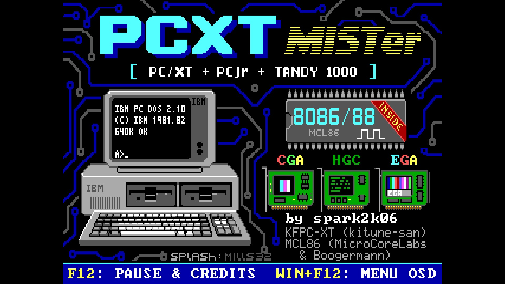

# [IBM PC/XT](https://en.wikipedia.org/wiki/IBM_Personal_Computer_XT) for [MiSTer FPGA](https://mister-devel.github.io/MkDocs_MiSTer/)

PCXT port for MiSTer by [@spark2k06](https://github.com/spark2k06/).

Discussion and development take place in the
[MiSTerFPGA PCXT forum section](https://misterfpga.org/viewforum.php?f=40).



## Description

This core recreates an IBM PC/XT-compatible machine as RTL running on MiSTer.
The design is built around the [MCL86 CPU](https://github.com/MicroCoreLabs/Projects/tree/master/MCL86),
the [KFPC-XT chipset](https://github.com/kitune-san/KFPC-XT), and the MiSTer
framework. The aim is a practical, observable PC/XT: real bus transactions,
chipset timing, memory windows, video I/O and peripherals are represented in
the FPGA rather than emulated by a host operating system.

One core covers three machines, chosen in the OSD and applied at the next
reset: the IBM PC/XT, the Tandy 1000 (CGA with its Tandy video modes and
Tandy sound) and the IBM PCjr (its video gate array, IR keyboard and
cartridges).

The PC/XT has two video choices: CGA and HGC/MDA together, or an IBM EGA card.
CGA provides the native 200-line colour/composite raster; HGC/MDA provides the
monochrome text and graphics raster. Both can be present at the same time, and
the OSD or F11 can select which connector path is shown. HGC/MDA's 350-line
timing can optionally be converted to a 15 kHz television raster without
changing the video hardware seen by DOS software. The EGA card is a strict IBM
EGA (modes 0–7, 0Dh, 0Eh, 0Fh and 10h, 64-colour palette, 5151/5153/5154
monitors); it has no VGA modes.

AdLib sound uses [JTOPL](https://github.com/jotego/jtopl) by Jose Tejada
([@jotego](https://github.com/jotego)). The project also integrates C/MS,
the OPL2-compatible FM path, optional Tandy audio, PC speaker and MIDI/MT32-pi
support.

For the implementation notes behind the CPU and bus work, see
[`docs/8086-adaptation.md`](docs/8086-adaptation.md). 

For an architectural overview and possible future improvements, see the
[PCXT technical report](https://aitorgomez.net/pcxt-cga/core-report) (source in
[`docs/report/`](docs/report/CORE_REPORT.html)).

## Key features

* IBM PC/XT, Tandy 1000 or IBM PCjr in one core, chosen in the OSD (**Machine**); one or more of them can be kept as separate entries of the menu with [MGL profiles](#profiles-mgl)
* Selectable 8088 or 8086 bus mode, applied safely with **Reset & apply settings**
* CPU speeds of 4.77 MHz, 7.16 MHz, 9.54 MHz and **Max**; Max is an unthrottled performance profile, not a historical CPU grade
* Optional **Fake 286 FLAGS** compatibility behaviour for software that probes reserved FLAGS bits
* IBM PC/XT 5160-compatible chipset, BIOS, DMA, IRQ, PIT, keyboard and disk services
* 640 KiB conventional memory, optional A0000h UMB, and EMS up to 2 MiB
* Native CGA text/graphics modes with simulated composite colour and selectable display tint
* Hercules-compatible monochrome text and graphics modes through the HGC/MDA path
* CGA and HGC/MDA available together, with OSD selection and **F11** video-output swap
* IBM EGA card as the alternative PC/XT video (**PCXT Video**), with the 5151, 5153 and 5154 monitors
* Tandy 1000 video modes and sound; PCjr video gate array, IR keyboard, two cartridge slots, 128–640 KiB of RAM and tape sound
* HGC/MDA 350-line conversion to **480i 15 kHz** or **240p 15 kHz**; CGA bypasses this converter
* A single 320×200, 16-colour graphical boot splash for the whole XT family, also used while HGC/MDA is selected
* **F12** pause and credits on the splash as well as after the machine starts
* Startup hold with an on-screen notice when no PCXT BIOS is loaded
* XTIDE option-ROM support and two SD-backed storage targets
* AdLib OPL2, C/MS, Sound Blaster Pro, Tandy audio, PC speaker and MIDI/MT32-pi
* Joystick support and serial mouse support on COM1

## Video architecture

### CGA

CGA is implemented as a real 6845-style raster path with its own VRAM,
sequencer, attribute logic and composite decoder. The graphical splash is a
320×200, 16-colour RGBI picture stored in `rtl/video/splash_320x200.hex`, two
pixels per byte; it is rendered through the CGA RGBI stream so the same timing
and composite colour behaviour apply to the splash and to normal CGA software.
`SW/make_splash_rom.py` (or `SW/make_splash_rom.ps1`, without Python) builds
the ROM from `SW/splash_320x200_source.png`.

The **Composite video** OSD option enables the simulated NTSC colour decoder.
**Display** selects the RGBI presentation (full colour, green, amber, B&W,
red, blue, fuchsia or purple), while **Border** exposes the active border.

**CRTC Frame Stacking** (`Native` by default) is for software that makes the
6845 start a new frame on every scanline, so that each line gets its own start
address (per-line scrolling, mirrors, ripples). The trick programs a tiny frame
(R4 set to 0 or 1, R9 set to 0) and rewrites R0/R1/R2 in the middle of every
line, and each write has to land within a few characters of its slot. The
end-credits water reflection of the *Area 5150* demo is one example.
`Native` runs the trick on the CRTC as it is, which needs CPU and bus timing
that is cycle-exact with the CGA; the core does not reach that. `Rebuilt`
keeps the registers as before, but records the start addresses in the order
they are written and shows them on a stable 80-column raster of its own, so
the picture depends on the order of the writes rather than on their timing.
Each picture is one complete frame of the program, even when the program's
frames do not last exactly one 262-line picture; while this raster is shown,
the status port (3DA) follows it. Rebuilt lines use the split Area 5150 uses: 80
characters from A+1 in glyph row 0, plus character A in the right overscan,
as on an IBM CGA. A program that splits its lines differently is still shown
on a stable raster, but not necessarily where a real CGA puts it. Rebuilt
only takes over when R0 is rewritten on every line as well; frames of one or
two whole scanlines, which the CRTC times by itself, stay native. The normal
CRTC output returns a few frames after the pattern stops.
`rtl/video/TESTBENCH/cga_frame_stack_tb.sv` replays a real 5150 bus capture
of the Area 5150 effect, with and without timing errors.

### HGC/MDA

The HGC path implements the B0000h/B8000h video apertures, monochrome text,
Hercules graphics and the corresponding CRTC/sequencer timing. It is available
alongside CGA when both build macros are enabled. **PCXT 1st Video** selects
which card the BIOS should treat as the first display; **F11** swaps the
MiSTer output between the two live video paths.

HGC/MDA's native 350-line raster is not a 15 kHz progressive television mode.
When **350-line CRT** is set to `480i 15 kHz` or `240p 15 kHz`, the core captures
a complete HGC/MDA frame in DDRAM and reads it back on a television-compatible
raster. `480i` displays all source lines across two fields; `240p` is steady
and progressive but reduces the active vertical detail. `Native` leaves the
card's original raster untouched. CGA never enters this framebuffer path.

The conversion is deliberately outside the emulated card: the CRTC registers,
display-enable timing, retrace bits and software-visible memory remain HGC/MDA
timing in every setting. `CRT H offset` and `CRT V offset` centre the converted
television raster; `Native` is intended for a display or scaler that accepts
the original 350-line output.

### Splash and credits

The splash is always generated by the CGA renderer; builds without the CGA
family draw the same picture through the EGA path, from the same ROM
(`rtl/video/splash_rom.v`, one read port per renderer). This keeps the startup
picture stable and colour-capable even if HGC/MDA is the selected first video;
the selected HGC/MDA path is restored when the splash has finished. If the
required PCXT BIOS is absent, the core holds the splash and reports the exact
OSD section to use instead of releasing the CPU into an empty F0000h region.

**Splash time** (System & BIOS page) shows it for 5, 10 or 15 seconds, or
not at all with 0 s. The picture fades in when it appears and out over its last
second, on the CGA path (RGB and composite) and on the EGA one alike.

F12 pauses the splash countdown and shows the credits. Press F12 again to
resume. The same credits module is used after boot when the machine is paused.

## Memory map

The CPU exposes a 1 MiB physical address space. The active overlays depend on
the enabled build features, the selected video card and the OSD settings.

| Address range | Core assignment |
| --- | --- |
| `00000h–9FFFFh` | 640 KiB conventional SDRAM |
| `A0000h–AFFFFh` | Optional SDRAM-backed A000 UMB; disabled by default in a minimal build |
| `B0000h–B7FFFh` | HGC/MDA video aperture when the Hercules page is selected |
| `B8000h–BFFFFh` | CGA colour/text aperture, or HGC/MDA page 1 |
| `A0000h–BFFFFh` | EGA video memory, as its Miscellaneous register maps it, when the EGA card is selected |
| `C0000h–EFFFFh` | EMS page-frame overlay when enabled (D000h, or as chosen in the OSD; see below) |
| `EC000h–EFFFFh` | XTIDE ROM window when an EC00 BIOS is loaded and not overlaid by EMS |
| `F0000h–FFFFFh` | PCXT system BIOS |

The video apertures are not conventional memory. In the builds that include
the EGA card (`mister_pcxt_full`, the default, and `mister_pcxt_ega`) the EMS
frame is fixed at D000h and the OSD offers an extra UMB at C400h–CFFFFh; the
A000 UMB is only offered while the CGA/HGC card is selected. The EMS frame can
be moved to C000h or E000h only in the `mister_pcxt_cga` build. On the Tandy
1000 and the PCjr the video memory is part of system RAM, as on the real
machines. EMS maps four 16 KiB banks through its page frame and is controlled
at I/O ports `260h–263h`.
Because EMS and option ROMs can occupy the same upper-memory ranges, DOS
configuration must match the selected EMS frame; see the supplied files under
`hdd/` and the notes in [`docs/`](docs/).

## OSD configuration

The default `config.tcl` build, the one published in `releases/`, is the
`mister_pcxt_full` profile: the IBM PCXT, the Tandy 1000 and the IBM PCjr as
machines, CGA, HGC and EGA as video cards, OPL2, C/MS, the Sound Blaster Pro,
EMS, the A000 UMB and MIDI. The machine and the video card are chosen in the OSD
and applied at the next reset. Smaller builds with only part of this can be
compiled from the other profiles (see [Building](#building)).

The main OSD groups are:

| Group | Options of interest |
| --- | --- |
| Disks | Floppy A/B, write protection, IDE images and second SD card |
| CPU | 4.77 MHz, 7.16 MHz, 9.54 MHz, Max |
| System & BIOS | Machine, PCXT Video (CGA/HGC or EGA), CGA/HGC enable, first video, splash time, CPU type, Fake 286 FLAGS, the BIOS of each machine (PCXT, Tandy, PCjr), EGA BIOS, EC00 ROM, PCjr cartridges and RAM, BIOS write protection |
| Audio & Video | OPL2/CMS, Sound Blaster, Tandy sound, tape sound (PCjr), speaker and audio boost, mixing, CRT offsets, sync widths, scaler effect, aspect ratio, border, CRTC frame stacking, composite and display tint |
| Audio & Video | HGC/MDA `350-line CRT`: Native, 480i 15 kHz or 240p 15 kHz |
| Hardware | EMS, UMBs, EGA monitor, Sound Blaster IRQ, MPU-401, joysticks, joystick swap and CPU-speed synchronisation |

Options that do not apply to the chosen machine or card are hidden: the
Tandy 1000 and the PCjr have no HGC or EGA, and the PCjr has no expansion
cards, second floppy drive, hard disk or turbo.
| User I/O | MIDI, COM2 and MT32-pi options when `ENABLE_MIDI` is built |

The machine, the PC/XT video card, the PCjr RAM size, the CPU type and the
first-video state are latched during reset: after changing them, use
**Reset & apply settings** (the OSD shows that the change is pending until
then). Fake 286 FLAGS is a live compatibility control.

## Profiles (MGL)

A MiSTer MGL file can launch the core under a name of its own. Each name gets
its own configuration file (`config/<name>.CFG`), so the same RBF can appear
in the menu as several machines, each one with its own settings, BIOS and
disks, much like the configuration slots of other cores. With
`same_dir="1"` every profile keeps using the `games/PCXT` folder.

1. Create one `.mgl` file per profile in `_Computer`, next to the PCXT RBF.
   The file name is the name shown in the menu. For example, `PCXT-PCjr.mgl`:

   ```xml
   <mistergamedescription>
       <rbf>_Computer/PCXT</rbf>
       <setname same_dir="1">PCXT-PCjr</setname>
   </mistergamedescription>
   ```

   `PCXT-Tandy.mgl` and `PCXT-EGA.mgl` are the same file with `PCXT-Tandy` or
   `PCXT-EGA` as the `setname`. The `rbf` path matches the release RBF by its
   name, whatever its date. Avoid the name of another core, such as
   `Tandy1000`: the profile would read that core's saved configuration, whose
   options are laid out differently.
2. Launch the profile from the menu. The first time, it starts from the
   default settings: open the OSD, choose the **Machine** (and, for a PC/XT,
   the **PCXT Video** card), load the BIOS of that machine under
   **System & BIOS**, mount its disks and save the settings.
3. Select **Reset & apply settings**. From then on the profile starts as that
   machine.

The plain PCXT entry keeps using `config/PCXT.CFG`. Without `same_dir="1"` a
profile looks for its files in `games/<setname>` instead. The `setname` also
names the configuration, so renaming it later starts a fresh one.

These profiles are a feature of MiSTer's Main, not of the core, and need no
build of their own. The build profiles described in [Building](#building) are
something else: separate RBFs with only part of the hardware.

## Quick start

1. Copy the contents of `games/PCXT` to the MiSTer SD card and extract the
   included `hd_image.zip` if present.
2. Select **Computers / PCXT**.
3. Open the OSD with **Win + F12**.
4. Under **System & BIOS**, choose the **Machine** (IBM PCXT, Tandy 1000 or
   IBM PCjr) and, for a PC/XT, the **PCXT Video** card, the CPU type (8088 or
   8086) and the CPU speed.
5. Mount a floppy or hard-disk image.
6. Load the BIOS of that machine into its slot under **System & BIOS** (PCXT,
   Tandy or PCjr BIOS; the EGA card also needs an EGA BIOS).
7. Select **Reset & apply settings**.

For the first test, the PC/XT with the Micro8088 BIOS (`pcxt_xtsergey.rom`) and
the included FreeDOS hard-disk image are a practical combination. If the BIOS
of the chosen machine (or the EGA BIOS) is missing, the splash remains visible
and the OSD notice identifies the missing slot; this is expected and does not
require an HDMI display to recover.

The splash lasts five seconds by default. **Splash time** sets it to 5, 10 or
15 seconds, or 0 to skip it, and **F12** pauses it while showing the credits.

## ROM instructions

ROMs are loaded from the **System & BIOS** section of the OSD. Each machine
has its own BIOS slot (PCXT, Tandy and PCjr BIOS), and the one of the chosen
machine is required; the EGA card needs an IBM EGA BIOS in its own slot. The
EC00 slot accepts an XTIDE option ROM of up to 16 KiB; some system BIOS images
already contain XTIDE at F0000h and do not need the additional slot. The PCjr
has two cartridge slots (`.jrc` files) instead; loading one restarts the
machine so that the BIOS finds it.

Open or redistributable BIOS choices in the repository include:

* `pcxt_pcxt31.rom`, from [virtualxt/pcxtbios](https://github.com/virtualxt/pcxtbios)
* `pcxt_xtsergey.rom`, the Micro8088 / Xi 8088 BIOS from [skiselev/8088_bios](https://github.com/skiselev/8088_bios)
* `ide_xtl.rom`, from the [XTIDE Universal BIOS project](https://www.xtideuniversalbios.org/)

The scripts in `SW/ROMs/` prepare compatible images from the IBM 5160, Juko
ST and Tandy 1000 sources. Original copyrighted ROM dumps are not distributed
by this repository: the PCjr and EGA BIOS have to come from your own dumps. Not every BIOS has the same floppy geometry or video assumptions;
IBM 5160 commonly uses 360 KiB media, while Micro8088 commonly uses 720 KiB or
1.44 MiB media.

## Audio, input and storage

* **OPL2 / AdLib:** selectable at `388h`, or Sound Blaster FM-compatible `228h` when built and selected.
* **C/MS:** enabled at `220h–22Fh` when `ENABLE_CMS=1`.
* **FM-compatible address:** OPL2 can use the AdLib address `388h` or the Sound Blaster FM-compatible address `228h`, as selected in the OSD.
* **Sound Blaster Pro:** at `220h` (**Audio 220h**), IRQ 5 or 7.
* **Tandy audio:** SN76489-compatible audio at the classic Tandy I/O range. It is part of the Tandy 1000 and the PCjr, and can also be enabled on the PC/XT.
* **MIDI / MT32-pi:** MPU-401 UART at `330h–331h`, with MiSTer USER I/O and HPS USB MIDI options when enabled.
* **Mouse:** a serial mouse can be used on COM1 with a DOS driver such as CTMOUSE.
* **Joysticks:** two configurable analog or digital joystick inputs.
* **Storage:** floppy A/B, IDE-backed hard-disk images and an optional second SD target.

## Building

The standard Quartus project is `PCXT.qsf`. The build profile is picked with
the `PCXT_PROFILE` environment variable (`config.tcl` sources
`profiles/<profile>.tcl`); the profiles are `mister_pcxt_full` (PCXT, Tandy 1000
and PCjr, chosen in the OSD), `mister_pcxt_ega`, `mister_pcxt_cga`,
`mister_tandy1000` and `mister_pcjr`. Each profile sets its own fitter seed.
Only `mister_pcxt_full`, the default, is published in `releases/`; the other
profiles are there to build a core with a single machine or video family, for
instance to free FPGA resources or to keep the OSD of the earlier PCXT and
PCXT-EGA cores.
`scripts/build_profiles.sh` compiles them (Docker, `raetro/quartus:17.0`) and
prints ALM, M10K and the timing slack of the four corners.
For users of the earlier cores, see
[`docs/MIGRACION.md`](docs/MIGRACION.md). The EGA card is a strict EGA: the VGA
13h+ extension no longer exists. From WSL, the containerised build of one
profile is:

```sh
docker run --rm -e PCXT_PROFILE=mister_pcxt_full -v "$(pwd):/build" -w /build \
  raetro/quartus:17.0 quartus_sh --flow compile PCXT
```

The repository includes focused RTL testbenches under
`rtl/video/TESTBENCH/` and `rtl/KFPC-XT/TESTBENCH/`. The latter covers, among
other things, the CPU bus, memory refresh collisions, splash pause handling
and the missing-BIOS startup hold.

## Repository layout

* `PCXT.sv`, `config.tcl`, `PCXT.qsf` — MiSTer top level, feature profile and Quartus project
* `profiles/` — build profiles (`mister_pcxt_full` and the smaller ones)
* `rtl/video/` — CGA (with the Tandy and PCjr video), HGC/MDA, composite, scandoubler and 15 kHz framebuffer paths
* `rtl/mem/` — SDRAM controller and arbiter, memory map and the video fetch engines
* `vendor/pc_common/` — the EGA card and its SDRAM front end, pinned
* `rtl/KFPC-XT/` — chipset, CPU-facing bus, memory, peripherals and testbenches
* `rtl/common/` — MiSTer/common support, credits and shared memory blocks
* `rtl/sound/` — OPL2 and C/MS/Tandy-related sound cores
* `SW/ROMs/` — BIOS and XTIDE preparation scripts
* `SW/8088_bios/` — Micro8088 BIOS sources and build instructions
* `SW/XTCTL/` — legacy runtime-control utility and its port-level notes
* `credits/` — source text and converter for the JTFrame credits image
* `docs/` — implementation notes, documentation index and technical report

## Known scope

This is a PC/XT-class core (IBM PC/XT, Tandy 1000 and IBM PCjr) with CGA,
HGC/MDA and EGA video. It has no VGA and does not claim to be an SVGA or
general-purpose PC emulator. The `Max` CPU setting is
intentionally a throughput mode, and exact cycle behaviour should be expected
only from the named clock profiles. BIOS compatibility also varies by ROM and
media geometry.

## Credits and licence

MiSTer integration and continuing development by **Aitor Gómez García
(spark2k06)**, with contributions from the MCL86, KFPC-XT, KFPC-PCjr, JTFrame,
JTOPL, Graphics Gremlin, ao486, MS mouse, sound and MiSTer communities,
including **BoogerMann** among the project developers and collaborators, the
boot splash art by **Mills** and the COM2 fixes by **manfredi90**. See
[`credits/msg`](credits/msg) for the in-core credits list (F12 shows it).

BoogerMann contributed to the integration of the newer SystemVerilog MCL86
organisation: separate BIU and EU implementations, microcode support and
8088 wrappers. The integration also preserves the instruction-boundary
`INTR` sampling fix (`intr_delay`), making maskable interrupt recognition
deterministic across instruction timing and CPU speed profiles.

The repository is distributed under the GNU General Public License. Individual
integrated components retain their own copyright notices and licence terms.

## Developers

Please send contributions and pull requests to the prerelease branch. They are
reviewed periodically and merged into the main branch as part of releases.
